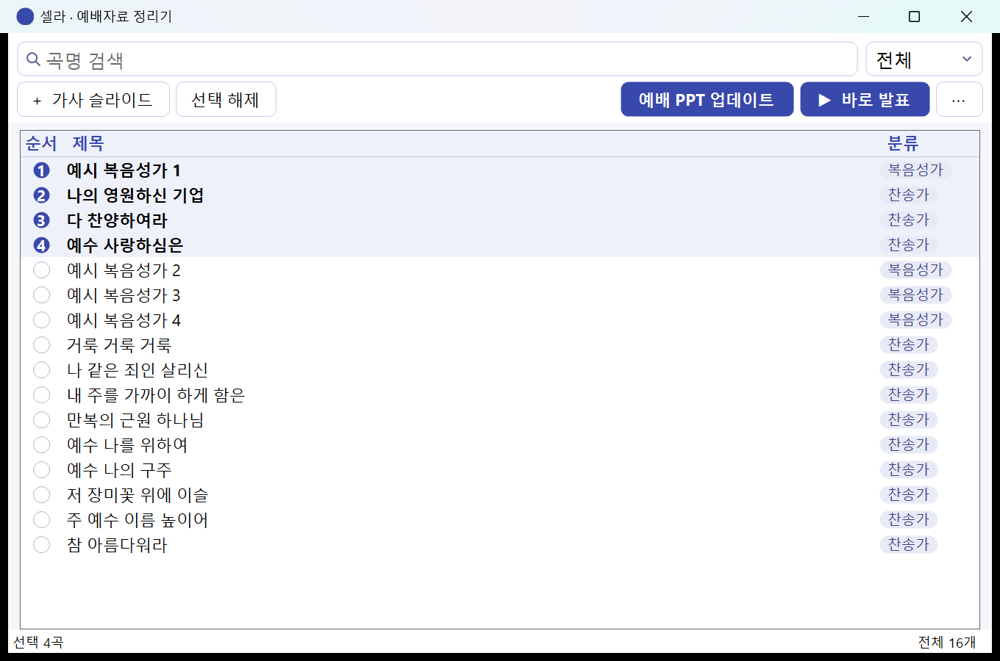
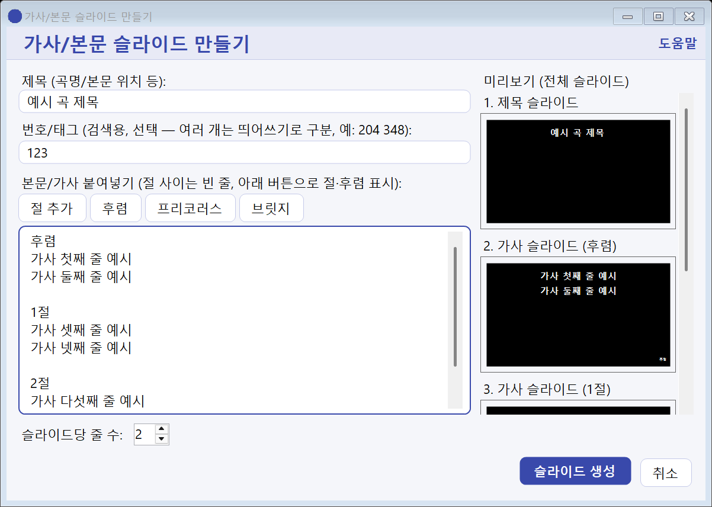

# 셀라 (예배자료 정리기)

찬송가·복음성가 PPT를 한곳에 모아 검색하고, 예배 순서대로 골라서 하나의 PPT로 합치거나 PowerPoint 없이 바로 발표할 수 있는 Windows 프로그램입니다. 교회에서 예배 자료를 준비하는 분들을 위해 만들었습니다.

## 이런 일을 합니다

- **곡 검색**: 폴더에 흩어진 PPT를 곡명으로 바로 찾습니다. 여러 단어를 띄어 쓰면 모두 포함된 곡을 찾습니다. 번호나 태그(예: 구 찬송가 번호)를 달아 두면 그 번호로도 찾아집니다.
- **순서 고르기**: 곡 왼쪽의 원을 눌러 예배 순서대로 고릅니다. 고른 곡은 번호가 매겨져 목록 맨 위에 모입니다.
- **예배 PPT 업데이트**: 고른 곡들을 순서대로 합쳐 하나의 파일로 저장합니다. 저장 위치를 한 번만 정하면 다음부터는 같은 파일이 계속 업데이트되어, 새 파일이 계속 생기지 않습니다. 합치는 도중 오류가 나도 기존 파일은 그대로 남습니다.
- **바로 발표**: 파일로 합치지 않고, 고른 순서 그대로 앱에서 전체화면으로 발표합니다(셀라 양식의 슬라이드에 가장 잘 맞습니다. [아래 안내](#바로-발표와-슬라이드-양식) 참고). 모니터가 둘이면 발표자 화면이 조작하는 모니터에 함께 나옵니다.
- **가사 슬라이드 만들기**: 가사나 성경 구절을 붙여 넣으면 검정 배경에 흰 글씨 슬라이드를 만들어 줍니다. 절 구분, 후렴·브릿지 표시가 자동으로 붙고, 오른쪽 미리보기로 결과를 확인할 수 있습니다.

## 설치

1. 이 저장소의 [Releases](../../releases/latest)에서 최신 설치파일(`Selah-Setup-….exe`)을 내려받습니다.
2. 내려받은 파일을 실행하고 안내를 따릅니다. 별도로 .NET이나 PowerPoint를 설치할 필요가 없습니다.
3. 시작 메뉴(또는 바탕화면)의 **셀라**를 실행합니다.

필요한 환경은 Windows 10 이상(64비트)입니다.

설치파일에는 디지털 서명이 없어서, Windows가 "PC를 보호했습니다"(SmartScreen) 화면을 보여 줄 수 있습니다. 이때 **추가 정보 → 실행**을 누르면 설치됩니다. 업데이트는 새 설치파일을 그대로 실행하면 기존 설정과 곡 목록을 유지한 채 덮어 설치됩니다.

## 처음 사용하기

1. 처음 실행하면 폴더 관리 창이 열립니다. **폴더 추가**로 찬송가 PPT가 들어 있는 폴더를 고릅니다. 폴더 이름이 곧 분류 이름이 됩니다. 폴더를 여러 개(예: 찬송가, 복음성가) 추가할 수 있습니다.
2. 곡 목록이 만들어지면 검색창에 곡명을 입력해 곡을 찾습니다. 검색창 오른쪽 끝의 ×를 누르면 입력한 글자가 한 번에 지워집니다.
3. 곡 왼쪽의 원을 눌러 순서를 고릅니다.
4. **예배 PPT 업데이트**로 한 파일에 합치거나, **▶ 바로 발표**로 바로 발표합니다.

폴더에 PPT를 새로 넣거나 바꾼 뒤에는 오른쪽 위의 **⋯ → 새로고침**을 누르면 목록에 반영됩니다. (.pptx 파일만 인식합니다.)

### 발표 중 조작

| 동작 | 키 / 마우스 |
|---|---|
| 다음 슬라이드 | 스페이스, →, PageDown, 화면 클릭 |
| 이전 슬라이드 | ←, PageUp |
| 종료 | Esc (마지막 슬라이드에서 → 를 두 번 눌러도 종료) |

발표자 화면에서는 마우스 휠로 앞뒤 슬라이드를 미리 보고, 슬라이드를 클릭하거나 Enter를 눌러 그 슬라이드로 이동합니다.

### 곡 우클릭 메뉴

제목 수정, 번호/태그 수정, 가사/제목 수정, 탐색기에서 보기, 파일 삭제(휴지통으로 이동)를 할 수 있습니다. 자세한 설명은 프로그램 안의 **⋯ → 도움말**에 있습니다.

## 바로 발표와 슬라이드 양식

**바로 발표는 셀라 양식의 슬라이드에서 가장 정확하게 나옵니다.** 셀라 양식은 셀라의 **가사 슬라이드 만들기**로 만든 슬라이드(검정 배경, 흰색 굵은 맑은 고딕)입니다. 이 양식은 PowerPoint에서 본 것과 똑같이 그려집니다.

다른 곳에서 받았거나 PowerPoint로 직접 만든 PPT는 셀라가 슬라이드 안의 글자, 이미지, 도형을 읽어서 최대한 비슷하게 그립니다. 글자와 이미지 중심의 슬라이드는 대체로 잘 나오지만 PowerPoint와 똑같지는 않습니다. 표, 차트, SmartArt, 그라데이션, 애니메이션, 슬라이드 마스터에서 가져오는 배경은 나타나지 않습니다.

- **양식이 다른 곡 찾기**: 오른쪽 위 **⋯ → 양식 확인**을 누르면 셀라 양식이 아닌 곡이 노란색으로 표시됩니다. (곡이 많으면 시간이 좀 걸립니다.)
- **셀라 양식으로 바꾸기**: 노란색 곡을 우클릭해 **가사/제목 수정**을 누르면 원본에서 뽑은 내용이 채워집니다. 절 구분과 후렴 표시가 맞는지 확인하고 **슬라이드 생성**을 누르면 그 파일이 셀라 양식으로 교체됩니다. 원본은 따로 보관하지 않으니 미리보기로 꼭 확인하세요.
- **그대로 두고 싶은 곡**이나 복잡한 슬라이드는 **예배 PPT 업데이트**로 하나의 파일로 합친 뒤 PowerPoint로 발표해 주세요.

## 알아 두세요

- **예배 PPT 업데이트와 바로 발표는 원본 PPT를 읽기만 합니다.** 원본 파일이 바뀌는 경우는 곡을 우클릭해서 직접 고칠 때뿐입니다. 번호/태그를 달면 파일의 '키워드' 속성에 기록되고, 제목 수정을 하면 파일 이름도 함께 바뀌고, **가사/제목 수정**으로 다시 만들면 그 파일이 새 내용으로 교체됩니다(원본은 따로 보관하지 않으니 미리보기로 확인하세요). 파일 삭제는 휴지통으로 옮깁니다.
- **인터넷에 연결하지 않습니다.** 프로그램에는 네트워크 통신 기능이 없고, 곡 목록은 내 PC에만 저장됩니다.
- 곡 목록과 설정은 `%AppData%\WorshipLibrary`에 저장되고, 문제가 생겼을 때 도움이 되는 기록(`log.txt`)도 같은 폴더에 남습니다. 곡 목록 파일(`library.db`)이 손상되면 프로그램이 알려 주고, 손상된 파일은 지우지 않고 옆으로 옮겨 둔 뒤 새로 시작할 수 있습니다.
- 폴더를 외장 하드나 USB에 두는 경우, 연결이 빠져 있으면 그 폴더는 새로고침에서 제외될 뿐 목록의 곡은 지워지지 않습니다.

## 저작권 안내

이 프로그램은 가사나 악보를 담고 있지 않습니다. 사용자가 붙여 넣은 내용을 슬라이드로 꾸며 줄 뿐이며, 어떤 곡의 가사를 쓸 수 있는지는 사용자가 직접 확인해야 합니다. 찬송가·복음성가의 가사 사용에 대한 책임은 사용자에게 있습니다. 교회에서 쓰는 곡의 저작권 허락(예: 한국 교회 저작권 관련 단체의 이용 허락 제도)이 필요한지 확인하시기 바랍니다.

## 사용 조건

- 개인과 교회가 예배·교육 목적으로 **무료**로 사용할 수 있습니다.
- 설치파일을 **수정하지 않은 그대로** 다른 교회나 다른 사람에게 전달해도 됩니다.
- 판매하거나, 수정·재포장해서 배포하는 것은 허락 없이 할 수 없습니다.
- 소스 코드는 공개하지 않습니다.
- 이 프로그램은 **있는 그대로** 제공되며, 사용으로 생기는 문제에 대해 어떤 보증도 하지 않습니다. 중요한 예배 자료는 미리 백업해 두세요.

## 문의와 오류 신고

[Issues](../../issues)에 남겨 주세요. 오류를 신고하실 때는 사용 중인 버전(설치파일 이름 또는 Windows 설정의 앱 목록에서 확인)과, 가능하면 `%AppData%\WorshipLibrary\log.txt`의 내용(곡 제목과 경로가 포함될 수 있으니 확인 후)을 함께 알려 주시면 원인을 찾는 데 큰 도움이 됩니다.

## 포함된 제3자 소프트웨어

이 프로그램은 Microsoft의 Open XML SDK와 SQLite 관련 라이브러리, .NET 런타임을 사용합니다. 각각의 라이선스는 [notices/THIRD-PARTY-NOTICES.txt](notices/THIRD-PARTY-NOTICES.txt)에 있고, 설치된 폴더의 `notices` 폴더에도 같은 파일이 들어 있습니다.
