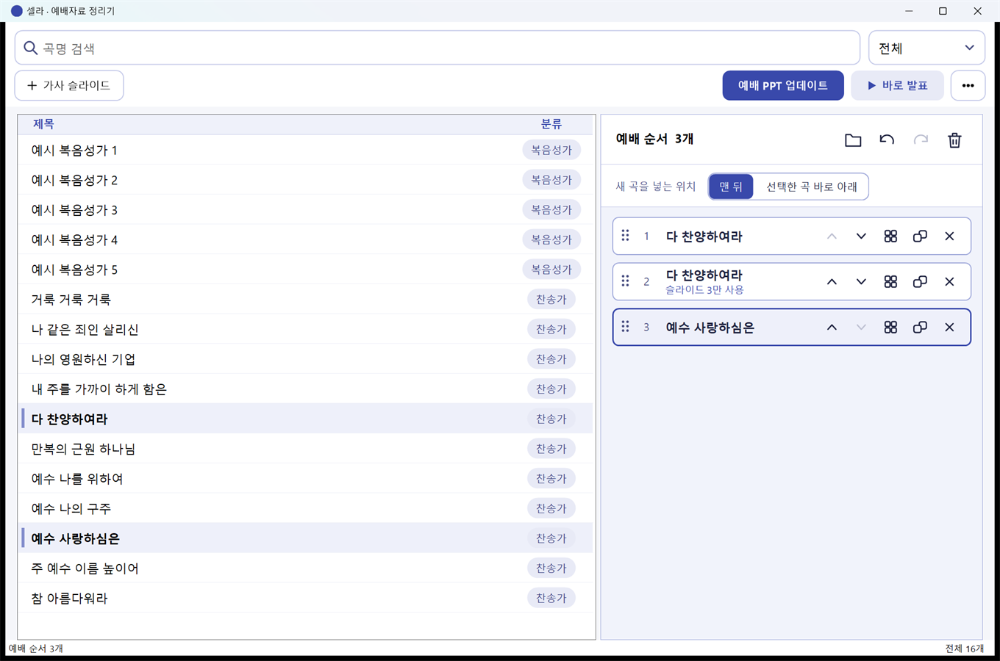
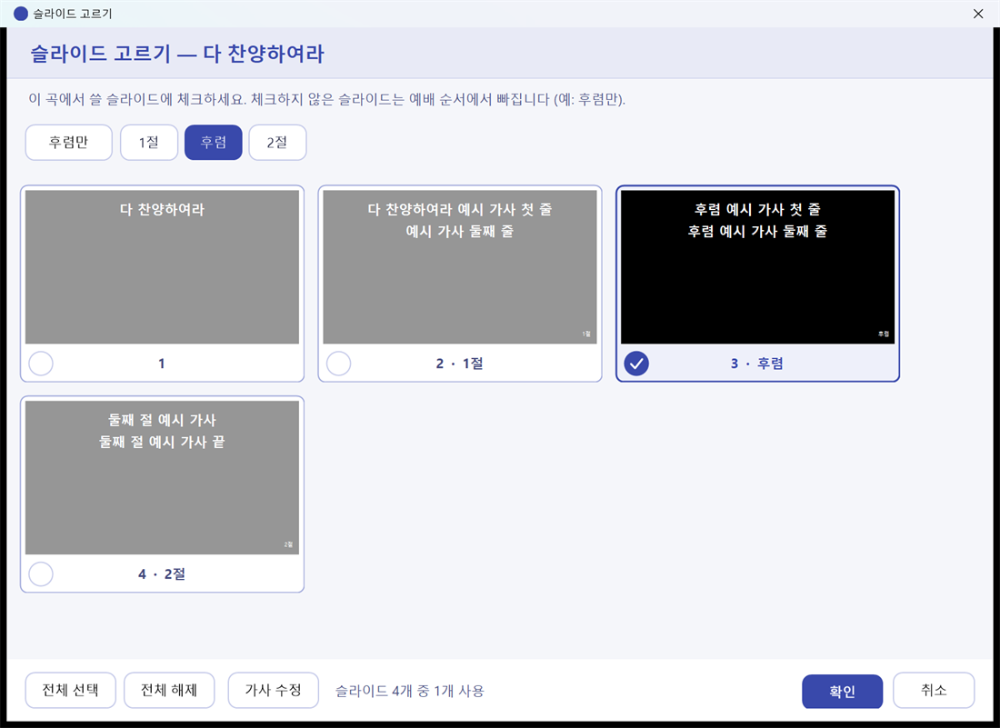
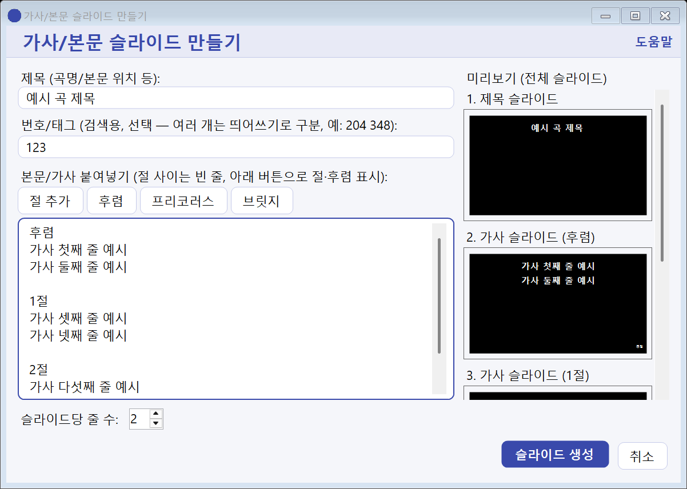

# 셀라 (예배자료 정리기)

찬송가·복음성가 PPT를 한곳에 모아 검색하고, 예배 순서대로 골라서 하나의 PPT로 합치거나 PowerPoint 없이 바로 발표할 수 있는 Windows 프로그램입니다. 교회에서 예배 자료를 준비하는 분들을 위해 만들었습니다.

## 이런 일을 합니다

- **곡 검색**: 폴더에 흩어진 PPT를 곡명으로 바로 찾습니다. 여러 단어를 띄어 쓰면 모두 포함된 곡을 찾습니다. 번호나 태그(예: 구 찬송가 번호)를 달아 두면 그 번호로도 찾아집니다. 띄어쓰기는 상관없고("주사랑" → "주 사랑"), 초성만 쳐도("ㄱㄱㅎㄴㅁ" → "갈급한 내 맘"), 한/영을 안 바꾸고 친 영문도("rkfrmqgks" → "갈급한") 찾아 줍니다.
- **예배 순서 만들기**: 곡을 누르면 오른쪽 "예배 순서"에 들어가고, 곡을 더블클릭하면 순서에 넣지 않고 그 곡의 PPT가 열립니다. 같은 곡을 여러 번 넣을 수 있고, 카드를 끌어서 순서를 바꾸고, 복제·빼기·되돌리기(Ctrl+Z)·다시 하기(Ctrl+Y)·복사 붙여넣기(Ctrl+C/V)를 할 수 있습니다. 카드를 더블클릭하면 그 곡의 PPT가 열립니다. 마지막 순서는 껐다 켜도 그대로 남습니다.
- **후렴만 넣기**: 카드의 네모 네 칸 버튼을 누르면 그 곡의 슬라이드가 그림으로 나옵니다. 쓸 슬라이드만 체크하면(예: 후렴만) 예배 PPT 업데이트와 바로 발표에 그 슬라이드만 들어갑니다. "후렴만", "1절" 같은 버튼으로 한 번에 고를 수 있고, 그 자리에서 가사를 고칠 수도 있습니다.
- **순서 저장**: 머리글의 폴더 버튼으로 지금 순서를 이름 붙여 저장해 두고 나중에 불러옵니다.
- **Avad 콘티 가져오기**: 예배 순서 머리글의 가져오기 버튼에 Avad 콘티 공유 링크를 붙여넣거나, Avad에서 **셀라로 보내기**를 누르면 그 콘티의 곡들로 예배 순서를 채웁니다. 찬송가는 장번호로, 나머지는 제목으로 곡을 찾고, 미리보기에서 못 찾은 곡을 직접 고르거나, 가사를 붙여넣어 그 자리에서 가사 슬라이드로 만들 수 있습니다(고른 곡·만든 곡은 다음부터 자동으로 맞춥니다). 곡을 모두 찾았을 때 미리보기 없이 바로 넣도록 설정할 수도 있습니다.
- **Avad 채팅 곡 바로 발표** (1.7.0부터): Avad 채팅에서 공유한 곡의 **셀라로 보내기**를 누르면 셀라가 그 곡을 찾아 바로 발표합니다. 못 찾았거나 비슷한 곡이 여럿이면 고르는 창이 뜨고, 고른 곡은 다음부터 바로 찾습니다. 발표 중이면 발표가 끝난 뒤 엽니다. 인터넷은 쓰지 않습니다.
- **이 곡만 발표**: 곡 줄이나 예배 순서 카드의 ▶ 버튼(또는 우클릭)으로 그 곡 하나만 바로 발표합니다.
- **자료 (영상·사진·설교/광고 PPT·유튜브·PDF)**: 목록 위 **찬양 | 자료** 전환으로 곡과 따로 정리해 둔 자료를 봅니다. 자료를 누르면 곡처럼 예배 순서에 들어가고, ▶ 버튼(또는 우클릭 → 바로 실행)은 바로 발표 화면에 띄웁니다. 더블클릭은 PC의 기본 프로그램으로 열어 봅니다. **자료 폴더** 버튼으로 영상·광고가 든 폴더를 추가합니다.
  - **바로 발표**에 자료가 섞여 있으면 순서대로 나옵니다. 사진은 슬라이드처럼 보이고, 영상·유튜브·설교 PPT·PDF는 그 차례의 검은 화면에서 →를 누르면 시작합니다. 재생 화면을 Esc로 닫거나 WPS 슬라이드 쇼가 끝나면 셀라 발표 화면으로 돌아오고, →로 다음 곡이 나옵니다. 예배 PPT 업데이트(합치기)에는 자료가 들어가지 않습니다.
  - 영상(mp4 등)과 유튜브는 검은 화면으로 시작해 스페이스나 클릭으로 재생·멈춤, Esc로 끝냅니다. 앱 안에서 재생하지 못하는 형식(wmv·avi·mkv 등)은 PC의 기본 재생기로 엽니다.
  - 사진은 ←/→로 같은 폴더의 다른 사진으로 넘깁니다.
  - 설교·광고 PPT는 WPS(없으면 PowerPoint) 슬라이드 쇼로 바로 시작합니다. 원본 파일은 건드리지 않습니다.
  - **+ 유튜브 링크**로 유튜브 주소를 자료 폴더에 저장해 둡니다. 유튜브는 인터넷이 연결돼 있어야 나옵니다.
  - **Avad 채팅 파일 받기** (1.6.0부터): Avad 채팅의 파일(영상·사진·PPT·PDF 등)에서 **셀라로 보내기**를 누르면 자료 폴더 안의 "Avad 공유" 폴더에 받아 두고 자료 목록에 보여 줍니다. 같은 이름이 있으면 덮어쓰지 않고 "이름 (2)"로 저장합니다. 100MB까지 받습니다.
- **양식이 다른 곡 표시**: 셀라 양식이 아닌 곡은 새로고침 때 자동으로 검사해 노란색으로 표시합니다([아래 안내](#바로-발표와-슬라이드-양식) 참고).
- **예배 PPT 업데이트**: 고른 곡들을 순서대로 합쳐 하나의 파일로 저장합니다. 저장 위치를 한 번만 정하면 다음부터는 같은 파일이 계속 업데이트되어, 새 파일이 계속 생기지 않습니다. 합친 파일은 맨 앞에 빈 검은 슬라이드가 하나 들어가서 검은 화면으로 시작합니다(⋯ → 설정에서 끌 수 있습니다). 합치는 도중 오류가 나도 기존 파일은 그대로 남습니다.
- **바로 발표**: 파일로 합치지 않고, 예배 순서 그대로 앱에서 전체화면으로 발표합니다. 발표는 검은 화면으로 시작하고, 처음 누르는 → (또는 클릭)에 첫 슬라이드가 나옵니다(셀라 양식의 슬라이드에 가장 잘 맞습니다. [아래 안내](#바로-발표와-슬라이드-양식) 참고). 모니터가 둘이면 발표자 화면이 조작하는 모니터에 함께 나오고, 발표를 띄울 화면은 ⋯ → 설정에서 고를 수 있습니다.
- **가사 슬라이드 만들기**: 가사나 성경 구절을 붙여 넣으면 검정 배경에 흰 글씨 슬라이드를 만들어 줍니다. 절 구분, 후렴·브릿지 표시가 자동으로 붙고, 오른쪽 미리보기로 결과를 확인할 수 있습니다. 한 줄이 상자보다 약간 길면(대략 17~20자) 글자가 자동으로 조금 작아져서(최소 40pt) 줄바꿈 없이 한 줄에 들어갑니다. 그보다 더 길면 자동으로 줄이 바뀌고, 미리보기에도 그대로 나타나니 직접 나눠 주세요. 이 규칙은 새로 만드는 슬라이드부터 적용되며, 이미 만든 곡은 우클릭 **가사/제목 수정**으로 다시 만들면 적용됩니다.

- **설정**: ⋯ → 설정에서 글자 크기(Ctrl +/- 로도 됩니다), 움직임 효과(느린 PC라면 끄세요), 예배 PPT 저장 위치, 발표 화면, 검은 화면 시작, Avad 콘티를 확인 없이 바로 가져오기를 정합니다.

## 설치

1. 이 저장소의 [Releases](../../releases/latest)에서 최신 설치파일(`Selah-Setup-….exe`)을 내려받습니다.
2. 내려받은 파일을 실행하고 안내를 따릅니다. 별도로 .NET이나 PowerPoint를 설치할 필요가 없습니다.
3. 시작 메뉴(또는 바탕화면)의 **셀라**를 실행합니다.

필요한 환경은 Windows 10 이상(64비트)입니다.

설치파일에는 디지털 서명이 없어서, Windows가 "PC를 보호했습니다"(SmartScreen) 화면을 보여 줄 수 있습니다. 이때 **추가 정보 → 실행**을 누르면 설치됩니다. 업데이트는 새 설치파일을 그대로 실행하면 기존 설정과 곡 목록을 유지한 채 덮어 설치됩니다.

## 처음 사용하기

1. 처음 실행하면 폴더 관리 창이 열립니다. **폴더 추가**로 찬송가 PPT가 들어 있는 폴더를 고릅니다. 폴더 이름이 곧 분류 이름이 됩니다. 폴더를 여러 개(예: 찬송가, 복음성가) 추가할 수 있습니다.
2. 곡 목록이 만들어지면 검색창에 곡명을 입력해 곡을 찾습니다. 검색창 오른쪽 끝의 ×를 누르면 입력한 글자가 한 번에 지워집니다.
3. 곡을 눌러 오른쪽 예배 순서에 넣고, 필요하면 끌어서 순서를 바꿉니다.
4. **예배 PPT 업데이트**로 한 파일에 합치거나, **▶ 바로 발표**로 바로 발표합니다.

폴더에 PPT를 새로 넣거나 바꾼 뒤에는 오른쪽 위의 **⋯ → 새로고침**을 누르면 목록에 반영됩니다. (.pptx 파일만 인식합니다.)

### 발표 중 조작

| 동작 | 키 / 마우스 |
|---|---|
| 다음 슬라이드 | 스페이스, →, PageDown, 화면 클릭 |
| 이전 슬라이드 | ←, PageUp (첫 슬라이드에서 누르면 검은 시작 화면으로 돌아감) |
| 종료 | Esc (마지막 슬라이드에서 → 를 두 번 눌러도 종료) |

발표자 화면에서는 마우스 휠로 앞뒤 슬라이드를 미리 보고, 슬라이드를 클릭하거나 Enter를 눌러 그 슬라이드로 이동합니다.

### 곡 우클릭 메뉴

이 곡만 발표, 파일 열기, 제목 수정, 번호/태그 수정, 가사/제목 수정, 탐색기에서 보기, 파일 삭제(휴지통으로 이동)를 할 수 있습니다. 자세한 설명은 프로그램 안의 **⋯ → 도움말**에 있습니다.

## 바로 발표와 슬라이드 양식

**바로 발표는 셀라 양식의 슬라이드에서 가장 정확하게 나옵니다.** 셀라 양식은 셀라의 **가사 슬라이드 만들기**로 만든 슬라이드(검정 배경, 흰색 굵은 맑은 고딕)입니다. 이 양식은 셀라가 구조를 정확히 알고 있어서 PowerPoint에서 본 것과 거의 같게 그려집니다.

다른 곳에서 받았거나 PowerPoint로 직접 만든 PPT는 셀라가 슬라이드 안의 글자, 이미지, 도형을 읽어서 최대한 비슷하게 그립니다. 글자와 이미지 중심의 슬라이드는 대체로 잘 나오지만 PowerPoint와 똑같지는 않습니다. 표, 차트, SmartArt, 그라데이션, 애니메이션, 슬라이드 마스터에서 가져오는 배경은 나타나지 않습니다.

- **양식이 다른 곡 찾기**: 셀라 양식이 아닌 곡은 노란색으로 표시됩니다. 새로고침 때 새로 넣거나 바뀐 파일만 뒤에서 자동으로 검사하고, 발표를 시작하면 검사를 멈춥니다. 표시가 이상할 때는 **⋯ → 양식 전체 다시 검사**를 누르세요.
- **셀라 양식으로 바꾸기**: 노란색 곡을 우클릭해 **가사/제목 수정**을 누르면 원본에서 뽑은 내용이 채워집니다. 절 구분과 후렴 표시가 맞는지 확인하고 **슬라이드 생성**을 누르면 그 파일이 셀라 양식으로 교체됩니다. 원본은 따로 보관하지 않으니 미리보기로 꼭 확인하세요.
- **그대로 두고 싶은 곡**이나 복잡한 슬라이드는 **예배 PPT 업데이트**로 하나의 파일로 합친 뒤 PowerPoint로 발표해 주세요.

## 알아 두세요

- **예배 PPT 업데이트와 바로 발표는 원본 PPT를 읽기만 합니다.** 원본 파일이 바뀌는 경우는 곡을 우클릭해서 직접 고칠 때뿐입니다. 번호/태그를 달면 파일의 '키워드' 속성에 기록되고, 제목 수정을 하면 파일 이름도 함께 바뀌고, **가사/제목 수정**으로 다시 만들면 그 파일이 새 내용으로 교체됩니다(원본은 따로 보관하지 않으니 미리보기로 확인하세요). 파일 삭제는 휴지통으로 옮깁니다.
- **인터넷은 세 가지 경우에만 씁니다.** Avad 콘티를 가져올 때(Avad 공개 주소에서 콘티의 곡 목록만 받음), Avad 채팅에서 보낸 파일을 받을 때(Avad가 파일을 올려 두는 저장소 주소에서만 받음), 자료의 유튜브 링크를 재생할 때입니다. 그 밖에는 인터넷에 연결하지 않고, 곡 목록은 내 PC에만 저장됩니다. 인터넷이 없는 PC에서도 나머지 기능은 그대로 쓸 수 있습니다.
- **셀라는 한 번에 하나만 켜집니다.** 이미 켜져 있을 때 다시 실행하면 켜져 있는 창이 앞으로 나옵니다. Avad의 "셀라로 보내기"가 셀라를 열 수 있도록, 셀라는 실행할 때 현재 사용자의 Windows 설정에 `selah://` 주소 연결을 등록합니다(관리자 권한 불필요).
- 영상·유튜브 재생 화면은 Windows에 들어 있는 Microsoft Edge WebView2를 씁니다. 없는 PC에서는 영상은 기본 재생기, 유튜브는 브라우저로 열립니다.
- 곡 목록과 설정은 `%AppData%\WorshipLibrary`에 저장되고, 문제가 생겼을 때 도움이 되는 기록(`log.txt`)도 같은 폴더에 남습니다. 곡 목록 파일(`library.db`)이 손상되면 프로그램이 알려 주고, 손상된 파일은 지우지 않고 옆으로 옮겨 둔 뒤 새로 시작할 수 있습니다.
- 폴더를 외장 하드나 USB에 두는 경우, 연결이 빠져 있으면 그 폴더는 새로고침에서 제외될 뿐 목록의 곡은 지워지지 않습니다. 연결이 빠진 상태에서 그 폴더의 곡으로 바로 발표나 예배 PPT 업데이트를 하면, 파일을 찾을 수 없다며 외장하드·USB 연결을 확인하라는 안내가 나옵니다.

## 저작권 안내

이 프로그램은 가사나 악보를 담고 있지 않습니다. 사용자가 붙여 넣은 내용을 슬라이드로 꾸며 줄 뿐이며, 어떤 곡의 가사를 쓸 수 있는지는 사용자가 직접 확인해야 합니다. 찬송가·복음성가의 가사 사용에 대한 책임은 사용자에게 있습니다. 교회에서 쓰는 곡의 저작권 허락(예: 한국 교회 저작권 관련 단체의 이용 허락 제도)이 필요한지 확인하시기 바랍니다.

## 사용 조건

- 개인과 교회가 예배·교육 목적으로 **무료**로 사용할 수 있습니다.
- 설치파일을 **수정하지 않은 그대로** 다른 교회나 다른 사람에게 전달해도 됩니다.
- 판매하거나, 수정·재포장해서 배포하는 것은 허락 없이 할 수 없습니다.
- 소스 코드는 공개하지 않습니다.
- 이 프로그램은 **있는 그대로** 제공되며, 사용으로 생기는 문제에 대해 어떤 보증도 하지 않습니다. 중요한 예배 자료는 미리 백업해 두세요.

## 문의와 오류 신고

[Issues](../../issues)에 남겨 주세요. 오류를 신고하실 때는 사용 중인 버전(설치파일 이름 또는 Windows 설정의 앱 목록에서 확인)과, 가능하면 `%AppData%\WorshipLibrary\log.txt`의 내용(곡 제목과 경로가 포함될 수 있으니 확인 후)을 함께 알려 주시면 원인을 찾는 데 큰 도움이 됩니다.

## 포함된 제3자 소프트웨어

이 프로그램은 Microsoft의 Open XML SDK와 WebView2 SDK, SQLite 관련 라이브러리, .NET 런타임을 사용합니다. 각각의 라이선스는 [notices/THIRD-PARTY-NOTICES.txt](notices/THIRD-PARTY-NOTICES.txt)에 있고, 설치된 폴더의 `notices` 폴더에도 같은 파일이 들어 있습니다.
